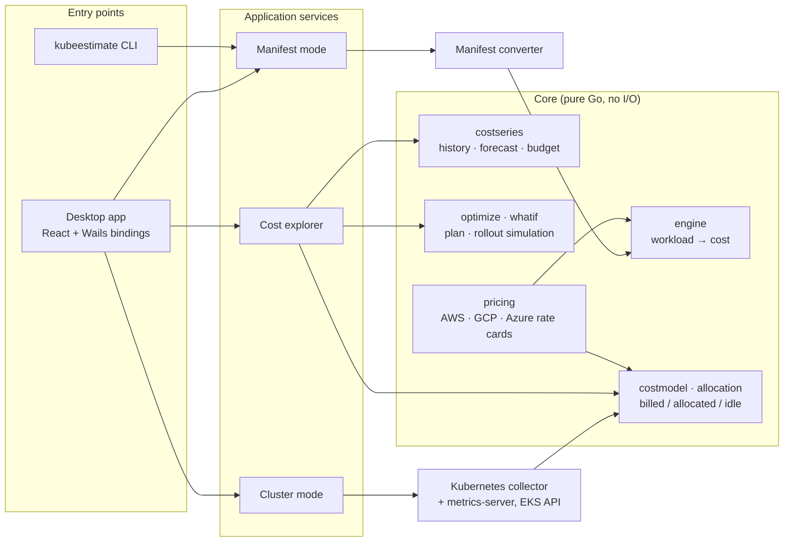

# Kube Cost Workspace

*The Kubernetes cost and capacity workspace.*

**A local desktop workspace for Kubernetes cost: check what a manifest will cost before you deploy it, see what your cluster runs and what it bills, and get a costed plan to cut that bill.**

Kube Cost Workspace is a Go + React desktop app (built with [Wails](https://wails.io)). It connects to your clusters with your own kubeconfig or AWS CLI session. It never stores cloud keys or Kubernetes tokens, and it never changes the cluster: every change it suggests is a command you review and run yourself.

## What it does

The app is organized into three workspaces that share one cost model, so a dollar figure means the same thing everywhere.

### Manifest: estimate before you deploy

- Drop, pick or paste a Deployment manifest and get its requested cost per hour, day and month, with a per-container and per-resource breakdown (CPU, memory, ephemeral storage, GPU).
- **Catalog pricing**: price it on AWS, GCP or Azure with any supported region and machine type, and toggle between providers to compare them.
- **Connected-cluster pricing**: price it with the connected cluster's own node rates and simulate the rollout. The simulation shows whether it fits in idle capacity or needs new nodes, whether it is a new workload or an update of an existing one (with current and proposed replicas, requests and cost), and the resulting change to the cluster bill.
- Generates a context-pinned `kubectl apply` command to copy. Kube Cost Workspace never runs it.
- Keeps a local history of past estimations, which you can view or export as PDF.

### Cluster: see what is running

- Connect through any kubeconfig context, or to **Amazon EKS** directly (cluster name + region, with an optional profile or role ARN).
- **Overview**: cluster health, requested capacity on usable nodes, workloads with missing requests, unready workloads, and the top-requesting namespaces.
- **Workloads, Resources, Namespaces, Nodes**: a live inventory with readiness, requests and capacity, plus live YAML inspection.
- **Provider** (EKS): cluster identity, network, managed node groups and add-ons.
- Reads usage from metrics-server when it is installed, so requested capacity can be compared with actual use.

### Cost: understand and reduce the bill

Cost figures come from AWS, Google Cloud and Azure public list prices, matched to each node's machine type, region and purchase option (on-demand or spot).

- **Cost explorer**: billed infrastructure (nodes, control plane, volumes) against cost allocated to workloads, plus **idle capacity** (billed but requested by nobody). Allocation can be grouped by namespace or workload, and you can see used vs requested efficiency, cost per node group, and history trends.
- **Budget & forecast**: set a monthly budget and get a month-end forecast from the recorded cost history, the date the budget runs out, and a "what changed?" breakdown of the drivers between two periods.
- **Optimizations**: a single plan from today's bill to the optimized bill. It covers orphaned volumes, rightsizing, removing nodes, better machine types and moving stateless work to spot. It is shown as a waterfall where each step only claims the saving it adds. Each recommendation has a risk note and the exact `kubectl`/`aws`/`eksctl` commands. Track it through *apply → confirm* as you run the steps, or dismiss it and the plan recalculates.
- Export reports as CSV or PDF.

### CLI

`kubeestimate` brings the same engine to the terminal for quick manifest estimates and scripting (see [CLI usage](#cli-usage)).

## How it works



- `core/` holds all cost logic and has no Kubernetes, Wails, cloud SDK or file I/O dependencies.
- Entry points translate input and output only and never reimplement pricing.
- The app keeps budgets, cost history and recommendation state in your user config directory.

Design notes: [architecture](docs/architecture.md), [core contract](docs/core-contract.md), [layer contracts](docs/layer-contracts.md), [cost explorer design](docs/cost-explorer-design.md).

## Getting started

### Desktop app

Requirements: Go 1.25+, Node.js, and the Wails CLI.

```sh
go install github.com/wailsapp/wails/v2/cmd/wails@v2.15.0
cd frontend && npm install && cd ..
```

On Ubuntu, install the native dependencies (24.04+ uses WebKitGTK 4.1):

```sh
sudo apt install libgtk-3-dev libwebkit2gtk-4.1-dev pkg-config
```

Run in development mode from the repository root:

```sh
wails dev                      # Windows, macOS, WebKitGTK 4.0
wails dev -tags webkit2_41     # Ubuntu 24.04+
```

Use `wails build` to produce a standalone binary. `npm run dev` inside `frontend/` serves the UI alone; estimation requires the Wails shell.

### Connecting an EKS cluster

Kube Cost Workspace uses the local AWS CLI and kubeconfig `exec` authentication. You need:

- AWS CLI v2 on the app's `PATH` and an authenticated session (for example `aws sso login --profile company-dev`)
- `eks:DescribeCluster` on your IAM principal
- Kubernetes access through an EKS access entry or RBAC
- VPN or network access to the VPC for private endpoints

Choose **Amazon EKS** in the connection dialog. Kube Cost Workspace runs `aws eks update-kubeconfig`, creates an `eks/<cluster>/<region>` context and validates it. It never switches your current kubeconfig context.

Install metrics-server on the cluster to get the usage, efficiency and rightsizing views.

### Demo clusters

- [k8s-local-cluster-tool/](k8s-local-cluster-tool/): a kind cluster for the Cluster workspace.
- [k8s-eks-cluster-tool/showcase/](k8s-eks-cluster-tool/showcase/README.md): an EKS cluster built so that every cost and optimization view has a real story to show (about $0.45/h; destroy it after use).
- [data/manifests/](data/manifests/): sample manifests, valid and invalid.

## CLI usage

```sh
go install ./cmd/kubeestimate
# make sure $(go env GOPATH)/bin is on your PATH

kubeestimate -f deployment.yaml                                   # AWS, us-east-1, m6i.large
kubeestimate -f deployment.yaml --provider aws   --region eu-west-1   --instance-type c6i.large
kubeestimate -f deployment.yaml --provider gcp   --region us-central1 --instance-type e2-standard-2
kubeestimate -f deployment.yaml --provider azure --region eastus      --instance-type Standard_D2s_v5
```

Any value you omit falls back to the provider's default, and the CLI prints an advisory for each assumption. Output is hourly and daily USD.

## Current limits

- Manifest mode supports `apps/v1` Deployments, one file at a time.
- The CLI estimates manifests only. Cluster and cost analysis are only in the desktop app.
- Prices are bundled list-price snapshots for a set of regions. They do not cover discounts, savings plans, root disks or public IPs.
- Any cluster can be inspected, but only nodes on AWS, GCP or Azure can be priced. Direct connection and the Provider view exist only for EKS so far.
- Costs are calculated from requests and node rates. They are an estimate, not your cloud invoice.

## Roadmap

**Done**

- [x] Core cost engine with AWS, GCP and Azure pricing and provider comparison
- [x] Manifest converter and `kubeestimate` CLI
- [x] Desktop app: manifest estimator, estimation history, PDF export
- [x] Cluster workspace: overview, workloads, resources, namespaces, nodes, live YAML
- [x] EKS connection, provider metadata and metrics-server usage
- [x] Cost explorer: billed vs allocated vs idle, by namespace, workload and node group
- [x] Budget & forecast with change drivers
- [x] Optimizations plan with apply/confirm tracking
- [x] Manifest rollout simulation against the connected cluster
- [x] CSV/PDF export and EKS showcase cluster

**Next**

- [ ] More manifest kinds (StatefulSet, DaemonSet, Job/CronJob), multi-document YAML and folders
- [ ] `kubectl-cost-workspace` plugin for manifest and cluster estimates (`kubectl cost-workspace estimate -f app.yaml`)
- [ ] GitHub Action that posts cost deltas on pull requests, with thresholds
- [ ] Kubernetes admission webhook for cost policy
- [ ] Direct GKE and AKS connections with provider views
- [ ] Persistent cluster history and deeper usage analysis
- [ ] ML/LLM-assisted cost prediction (exploratory)
- [ ] Final documentation, design write-up and showcase

## Repository layout

```text
main.go                 Wails desktop entry point
frontend/               React + TypeScript UI
cmd/kubeestimate/       CLI
core/                   pure cost logic: engine, pricing, costmodel, allocation,
                        costseries, optimize, whatif
internal/
  adapters/             Wails bindings and Kubernetes collector
  application/          manifest, cluster and cost-explorer use cases
  converter/            manifest → workload
  providers/            AWS, GCP, Azure catalogs and EKS integration
  storage/              local budget, cost-history and recommendation stores
docs/                   architecture and design notes
k8s-*-cluster-tool/     demo clusters
```

## License

See [LICENSE](LICENSE).
