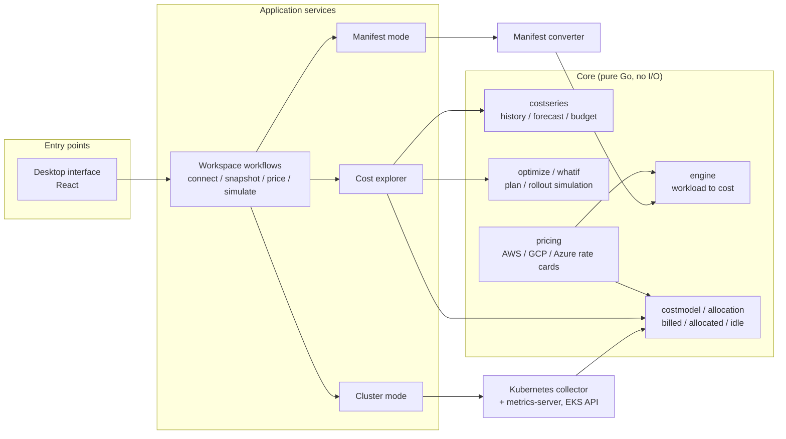
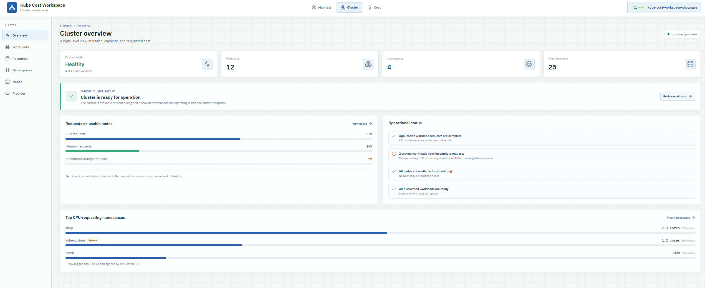

# Kube Cost Workspace

A Kubernetes cost and capacity analysis tool written in Go, with a local
desktop workspace for estimation, cluster inspection, and optimization.

## Overview

Kube Cost Workspace brings together Kubernetes resource analysis and cost
modeling to help estimate workloads before deployment, understand how a running
cluster uses its capacity, and identify opportunities to reduce infrastructure
spending. Its Go backend converts manifests, collects Kubernetes data, and
calculates estimates, forecasts, and optimization plans, with a React desktop
interface for exploring the results in one place.

The application runs locally using your existing kubeconfig or AWS CLI session,
without storing cloud keys or Kubernetes tokens. Cluster access is read-only:
suggested changes are provided as commands that you review and run yourself.
For complementary terminal workflows, the optional `kubeestimate` tool reuses
the same services and cost model; installation and usage are covered in the
[CLI guide](CLI.md).

## Architecture Overview

The architecture centers on a pure Go cost core, separated from Kubernetes
API access, cloud integrations, persistence, and presentation. Application
workflows in `internal/application/workspace` coordinate manifest conversion,
cluster collection, provider pricing, and local data.



For the system design and component boundaries, see the
[architecture overview](docs/architecture.md) and
[layer contracts](docs/layer-contracts.md).

## Features

- Deployment manifest estimates per hour, day, and month, with CPU, memory,
    ephemeral storage, GPU, and per-container breakdowns
- AWS, Google Cloud, and Azure catalog pricing with provider comparison
- Connected-cluster rollout simulation, including idle capacity, new nodes,
    workload updates, and the resulting change to the cluster bill
- Kubernetes inventory with workloads, resources, namespaces, nodes, readiness,
    request coverage, and live YAML inspection
- Direct Amazon EKS connection and provider metadata for networks, managed node
    groups, and add-ons
- Actual usage from metrics-server when available
- Billed infrastructure costs for nodes, control plane, and volumes, with
    allocation by namespace or workload, idle capacity, node-group costs, and
    used-versus-requested efficiency
- Cost history, monthly budgets, month-end forecasts, budget exhaustion dates,
    and change-driver analysis
- Optimization plans covering orphaned volumes, rightsizing, node removal,
    machine-type changes, and stateless workloads on spot
- Recommendation risk notes, reviewable commands, and desktop apply/confirm
    tracking with dismissal support
- Estimation history and CSV/PDF reports

### Explicitly out of scope

- Direct AKS/GKE connection and provider views equivalent to the EKS integration
- Discounts, savings plans, root disks, and public IP pricing
- Manifest kinds other than `apps/v1` Deployments, multi-document YAML, or
    processing multiple files at once
- Applying manifests or executing optimization commands on your behalf

## Repository Structure

```text
main.go                 # Desktop application entry point
frontend/               # React + TypeScript UI
cmd/kubeestimate/       # CLI entry point and commands
core/                   # Pure cost logic: engine, pricing, costmodel, allocation,
                                                # costseries, optimize, whatif
internal/
    adapters/             # Desktop bindings and Kubernetes collector
    application/          # Manifest, cluster, cost-explorer, and shared workflows
    converter/            # Kubernetes manifest to workload conversion
    providers/            # AWS, GCP, Azure catalogs and EKS integration
    storage/              # Local budget, cost-history, and recommendation stores
docs/                   # Architecture and design documentation
data/manifests/         # Sample manifests, valid and invalid
k8s-local-cluster-tool/ # Local kind demo cluster
k8s-eks-cluster-tool/   # EKS demo and showcase clusters
```

## Documentation

The project documentation is organized through the [documentation index](docs/README.md).

Start with [docs/README.md](docs/README.md) for a guided entry point to the
architecture, cost model contracts, design notes, and supporting tool guides.

## Getting Started

The desktop application uses [Wails](https://wails.io) to connect the Go backend
to the React interface and run it locally.

### Prerequisites

- Go 1.25 or later: [installation guide](https://go.dev/doc/install)
- Node.js and npm for the desktop frontend: [installation guide](https://docs.npmjs.com/downloading-and-installing-node-js-and-npm)
- Wails CLI for desktop development and builds: [installation and platform dependencies](https://wails.io/docs/gettingstarted/installation/)
- A kubeconfig with cluster access for connected-cluster workflows: [kubeconfig setup guide](https://kubernetes.io/docs/tasks/access-application-cluster/configure-access-multiple-clusters/)
- AWS CLI v2 and an authenticated session for direct EKS connections: [installation](https://docs.aws.amazon.com/cli/latest/userguide/getting-started-install.html) and [authentication setup](https://docs.aws.amazon.com/cli/latest/userguide/cli-chap-authentication.html)
- metrics-server on the cluster for usage, efficiency, and rightsizing views: [installation and cluster requirements](https://github.com/kubernetes-sigs/metrics-server#installation)

Manifest estimates using catalog pricing do not require a cluster connection.

### Desktop setup

From the repository root:

```bash
go install github.com/wailsapp/wails/v2/cmd/wails@v2.15.0
cd frontend && npm install && cd ..
```

On Ubuntu 24.04 or later, install the native dependencies for WebKitGTK 4.1:

```bash
sudo apt install libgtk-3-dev libwebkit2gtk-4.1-dev pkg-config
```

### Connecting an EKS cluster

Kube Cost Workspace uses the local AWS CLI and kubeconfig `exec` authentication. You need:

- AWS CLI v2 on the app's `PATH` and an authenticated session (for example `aws sso login --profile company-dev`)
- `eks:DescribeCluster` on your IAM principal
- Kubernetes access through an EKS access entry or RBAC
- VPN or network access to the VPC for private endpoints

Choose **Amazon EKS** in the connection dialog. Kube Cost Workspace runs `aws eks update-kubeconfig`, creates an `eks/<cluster>/<region>` context and validates it. It never switches your current kubeconfig context.

## Usage

Run desktop development and build commands from the **project root**:

| Command | Description |
|---------|-------------|
| `wails dev -tags webkit2_41` | Start desktop development |
| `wails build -tags webkit2_41` | Build a standalone desktop binary |

The development command opens the desktop application. While it is running,
you can also access the development UI at
[http://localhost:34115](http://localhost:34115).



The application is organized into three workspaces that share one cost model.

| Workspace | Capabilities |
|-----------|--------------|
| **Manifest** | Drop, pick, or paste a Deployment; compare provider estimates or simulate it against the connected cluster; review per-container costs and export estimation history as PDF |
| **Cluster** | Connect through kubeconfig or EKS; inspect health, capacity, missing requests, unready workloads, top-requesting namespaces, resources, nodes, live YAML, and EKS provider metadata |
| **Cost** | Explore billed, allocated, and idle costs; compare usage with requests; review history, budget forecasts, change drivers, optimization plans, and CSV/PDF reports |

## Versioning

The current version of Kube Cost Workspace is `1.0.0`.

## Project Intent

I built Kube Cost Workspace to deepen my understanding of Kubernetes by
developing a practical tool in Go. Connecting manifests, resource requests,
node capacity, and usage metrics to infrastructure costs brought those concepts
together around a concrete problem: understanding what a workload needs and
what running it could cost. Implementing that analysis also gave me a way to
practice Go application design, separating the cost logic from Kubernetes
integrations and the desktop interface. The result is a learning and portfolio
project focused on making resource and cost decisions easier to understand,
while leaving control over cluster changes with the user.
