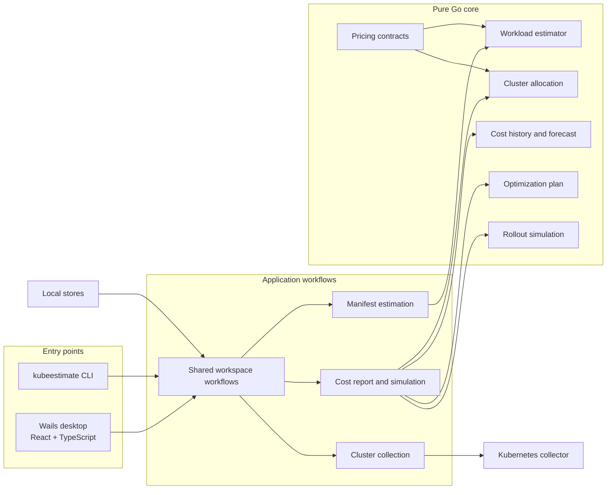

# Kube Cost Workspace Architecture

This document describes the architecture implemented in the repository. The
desktop application is the primary interface; `kubeestimate` is an optional
CLI that reuses the same application workflows and cost logic.

## System overview

The diagram shows ownership rather than every function call. Wails bindings
adapt desktop requests and results; the CLI adapts flags and terminal output.
Both delegate application behavior instead of maintaining separate cost
calculations.

## Implemented layers

### Entry points

- **Desktop:** Wails hosts the React and TypeScript interface and exposes Go
  adapters for manifest, cluster, cost, history, budget, and recommendation
  workflows.
- **CLI:** `cmd/kubeestimate` provides manifest estimates, cluster summaries,
  cost reports, and rollout simulation. It shares the application and core
  packages with the desktop app.

There is no implemented HTTP API, `kubectl` plugin, GitHub Action, or admission
webhook.

### Application workflows

`internal/application/manifest` converts one supported manifest into a
workload estimate. `internal/application/cluster` collects a live cluster into
a versioned snapshot. `internal/application/costexplorer` projects that
snapshot into the neutral allocation model and returns a cost report.

`internal/application/workspace` coordinates shared operations such as
connection, pricing, simulation, and local data access. It also selects the
provider and region used to price a report. The adapters own delivery details;
the application packages own the use cases.

### Core and integrations

Packages under `core/` contain calculation and planning logic without
Kubernetes API access, Wails bindings, or persistence:

| Package | Responsibility |
|---------|----------------|
| `engine`, `pricing` | Estimate one workload from resource requests and a rate configuration |
| `costmodel`, `allocation` | Represent and aggregate provisioned and requested costs |
| `costseries` | Integrate stored rates into history and forecast spend against budgets |
| `optimize` | Build an ordered, combined savings plan from a cost report |
| `whatif` | Simulate workload placement and compare the resulting report and plan |

`internal/converter` handles supported Kubernetes manifest input.
`internal/adapters/kubernetes` collects cluster data. Provider catalogs under
`internal/providers` resolve AWS, Google Cloud, and Azure list prices; AWS
integration also supplies EKS metadata when available. `internal/storage`
keeps local budgets, cost history, and recommendation state outside the core.

## Main workflows

### Manifest estimate

The manifest workflow accepts one `apps/v1` Deployment in YAML or JSON,
converts its container requests to the estimator's normalized input, resolves
catalog pricing, and returns hourly, daily, and monthly estimates. CPU, memory,
ephemeral-storage, and NVIDIA GPU requests can contribute to the estimate.
An optional HorizontalPodAutoscaler can supply a replica range where the caller
uses the converter's autoscaler helper.

When a cluster is connected, the desktop can also compare a new or updated
Deployment against the latest cluster cost report. This is a simulation; it
does not apply the manifest or modify cluster resources.

### Cluster and cost report

The collector records cluster identity, nodes, workloads, pods, namespaces,
resources, warnings, and available provider metadata. Metrics-server pod usage
is optional; a missing metrics source produces a warning rather than preventing
request-based pricing.

The cost explorer prices each node and its workloads, then reports requested
cost separately from provisioned cost. Idle node capacity and shared costs are
separate reconciled parts of the provisioned bill. Unsupported pricing or
incomplete collection is surfaced through report warnings and assumptions.

### History, budget, and optimization

Cost reports are captured locally while the application is used. The history
workflow integrates rates only across covered intervals; gaps are left
unestimated in history. The monthly forecast separates recorded spend,
estimated elapsed gaps, and projected future spend. A per-cluster budget is
compared against that forecast.

The optimization plan simulates ordered changes against one cluster scenario.
Recommendations include risk, effort, savings, and reviewable commands or
steps where the action is known. The app tracks applying, confirmed, dismissed,
and no-longer-detected recommendations; commands are not executed by the app.

## Important boundaries

- Requested cost, provisioned cost, and observed utilization answer different
  questions. They must not be added together or presented as interchangeable.
- Catalog estimates are not cloud invoices. Discounts, savings plans, data
  transfer, public IPs, and some infrastructure charges are outside the current
  model.
- Direct provider-management integration is EKS-specific. AWS, Google Cloud,
  and Azure catalogs can price supported nodes, but the application does not
  provide equivalent GKE or AKS management workflows.
- Manifest estimation is currently limited to a single Deployment file; it
  does not process a directory, multiple files, or multi-document YAML.
- Cluster collection uses the user's configured access. Suggested cluster
  changes remain under the user's control.

For the cost report's calculation and interpretation, see
[Cost model and explorer](cost-explorer-design.md). For package-level data
boundaries, see [Layer contracts](layer-contracts.md).